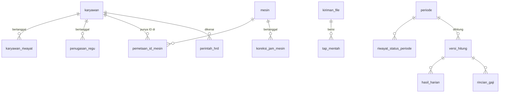

# Kontrak Data — Tahap 2

Versi 1.0 · **disetujui 12 November 2026** oleh pemilik proyek · acuan: PRD v3.1 aturan F2–F5, F10, F11

Dokumen ini menetapkan bentuk data sebelum tabel pertama dibuat. Perubahan bentuk data hanya lewat permintaan perubahan, karena semua bagian sistem bergantung padanya.

**Jalur Tahap 1,5 (disetujui):** file diurai di Supabase Edge Functions (pilihan 1 di `laporan-kelayakan-teknis.md`). Kontrak ini tidak bergantung pada pilihan itu.

## 1. Tujuh aturan dasar

1. **Satu pemasangan, satu perusahaan.** Tidak ada kolom perusahaan di tabel; tiap perusahaan punya database sendiri (PRD prinsip 2).
2. **Fakta hanya bertambah.** Tap, kiriman file, perintah HRD, dan riwayat karyawan tidak pernah diubah atau dihapus. Koreksi selalu baris baru yang merujuk baris lama.
3. **Turunan selalu bisa dibuat ulang.** Tap bersih, hasil per hari, dan rincian gaji dihitung dari fakta + aturan. Tidak ada yang mengeditnya dengan tangan; kalau salah, aturannya atau faktanya yang diperbaiki, lalu dihitung ulang.
4. **Satu pola bertanggal.** Setiap nilai yang bisa berubah (gaji, regu, aturan, pemetaan ID mesin) punya `berlaku_dari` dan `berlaku_sampai`, dibaca sebagai rentang setengah terbuka: berlaku mulai `berlaku_dari`, berhenti tepat sebelum `berlaku_sampai`. `berlaku_sampai` kosong berarti masih berlaku. Database menolak dua baris yang rentangnya tumpang tindih untuk kunci yang sama.
5. **Uang dan persen bilangan bulat.** Rupiah disimpan sebagai bilangan bulat. Persen disimpan dalam per-sepuluh-ribu (1% = 100, 0,24% = 24). Menit sebagai bilangan bulat.
6. **Waktu mesin apa adanya, plus zonanya.** Tap disimpan sebagai jam lokal mesin seperti tertulis di file, ditambah zona mesin dan koreksi jam mesin yang berlaku. Waktu baku dan tanggal kerja dihitung oleh satu fungsi.
7. **Tidak ada tabel yang terbuka langsung ke internet.** Tabel disimpan di schema yang tidak diekspos API Supabase. Dunia luar hanya bisa memanggil fungsi tertentu yang memeriksa peran pemanggil.

## 2. Pembagian schema

| Schema | Isi | Siapa yang menulis |
| --- | --- | --- |
| `induk` | Data karyawan, divisi, mesin, jadwal, kalender, pengguna | Perintah HRD dan file data karyawan |
| `aturan` | Semua angka aturan dan pengaturan perusahaan, bertanggal | Perintah pengaturan (HRD/bos), isi awal dari kuesioner |
| `fakta` | Kiriman file, tap mentah, perintah HRD, persetujuan, periode | Pintu masuk (Edge Function, bot) |
| `hitung` | Turunan: tap bersih, hasil per hari, rincian gaji, anomali, pembayaran | Hanya mesin hitung |
| `jejak` | Catatan perubahan, status proses, pemberitahuan terkirim | Otomatis |
| `api` | Fungsi dan tampilan yang boleh dipanggil dari luar (bot, web, Sheets) | Tidak berisi data sendiri |

## 3. Tipe data baku

| Jenis nilai | Tipe | Contoh |
| --- | --- | --- |
| ID karyawan, ID mesin | teks | `'10001'`, `'198001012010011001'` (tidak pernah angka) |
| Tanggal | `date` | `2026-03-20` |
| Jam lokal dari mesin | `timestamp` tanpa zona | `2026-03-20 23:02:41` |
| Waktu baku | `timestamptz` | dihitung, tidak disimpan di fakta |
| Rupiah | `bigint` | `3402892` |
| Persen | `integer` per-sepuluh-ribu | 1% → `100`; 2,5% → `250` |
| Menit | `integer` | `95` |
| Status dan jenis | teks dengan daftar nilai tetap (dicek database) | `'hadir'`, `'alpha'` |
| Sidik file | teks (SHA-256) | — |

## 4. Tabel fakta dan induk

Gambaran hubungan tabel utama:

### Schema `induk`

| Tabel | Isi utama | Catatan |
| --- | --- | --- |
| `karyawan` | ID, nama, tanggal lahir tidak disimpan | Identitas yang tidak berubah |
| `karyawan_riwayat` | Divisi, jabatan, tipe upah, gaji pokok, tunjangan tetap, PTKP, cara bayar, rekening (terenkripsi), wajib tap, gaji rahasia, BPJS aktif, berlaku dari/sampai | Satu baris per perubahan; kenaikan gaji dan mutasi masuk sini |
| `status_kerja` | Mulai kerja, berhenti (dengan alasan), aktif kembali | Urutan kejadian, bukan bertanggal |
| `divisi` | Kode, nama, pola jadwal, jumlah regu, mesin | |
| `mesin` | Kode, nama, zona waktu, penerjemah file yang dipakai | |
| `pemetaan_id_mesin` | Mesin, ID di mesin, karyawan, berlaku dari/sampai | Satu karyawan boleh lebih dari satu ID (celah M5, M6) |
| `koreksi_jam_mesin` | Mesin, selisih menit, berlaku dari/sampai | Celah M4 |
| `kode_jadwal` | Kode (P, S, M, K, …), jam masuk, jam pulang, istirahat dibayar atau tidak | Pulang lebih kecil dari masuk = lewat tengah malam |
| `pola_rotasi` | Pola, panjang siklus, urutan kode per hari, tanggal jangkar | Contoh: 4 regu, 8 hari, P P S S M M L L |
| `jadwal_hari` | Pola non-rotasi per hari dalam seminggu, bertanggal | Termasuk jadwal Ramadan |
| `penugasan_regu` | Karyawan, regu, berlaku dari/sampai | Mutasi regu |
| `kalender` | Tanggal, jenis (libur nasional, cuti bersama, libur perusahaan), keterangan | Libur mendadak (celah O5) masuk sini |
| `pengguna` | ID Telegram, peran (HRD, bos, karyawan, demo), karyawan terkait, PIN rilis (tersamar), aktif | |
| `kode_daftar` | Kode sekali pakai, karyawan, kedaluwarsa, dipakai pada | Celah K1 |

### Schema `fakta`

| Tabel | Isi utama | Catatan |
| --- | --- | --- |
| `kiriman_file` | Nama file, sidik SHA-256, pengirim, nomor pesan Telegram, jenis file, rentang tanggal, jumlah baris, status (diterima, ditolak, diproses, dibatalkan), alasan | Sidik dan nomor pesan sama → kiriman ditolak sebagai dobel (A7, L1) |
| `tap_mentah` | Kiriman, mesin, ID mesin, jam lokal, status di mesin, nomor baris asal | Disimpan apa adanya; tap yang sama dari dua kiriman tetap tercatat dua kali di sini, dan baru dibuang di turunan |
| `perintah_hrd` | Jenis (sakit, izin, cuti, absen manual, tukar shift, batalkan lembur, setujui lembur, penyesuaian, kasbon, tambah libur, …), karyawan atau divisi, tanggal mulai/selesai, nilai, alasan, pengirim, asal (chat/file), membatalkan perintah no. | Satu tabel untuk semua perintah; pembatalan adalah perintah baru |
| `persetujuan` | Yang disetujui (usulan tukar shift, lembur tanpa perintah, penyesuaian besar, rilis), penyetuju, keputusan, waktu | |
| `buku_kasbon` | Karyawan, jenis (pinjam, cicilan, pelunasan), jumlah, perintah asal | Saldo = jumlah baris, tidak disimpan |
| `periode` | Tanggal awal, tanggal akhir, tanggal bayar, status sekarang | |
| `riwayat_status_periode` | Periode, status lama, status baru, oleh, waktu, alasan | |
| `keberatan` | Karyawan, tanggal, isi, bukti tap, keputusan HRD | Tahap 8 |

### Schema `aturan`

Setiap tabel bertanggal (berlaku dari/sampai), dan setiap baris menyimpan siapa yang mengubah.

| Tabel | Isi |
| --- | --- |
| `pengaturan` | Pengaturan perusahaan dan divisi dari PRD bagian 11 (pola hari kerja, lembur otomatis atau wajib perintah, cuti bersama, pembulatan tunai, premi hadir, tunjangan shift, persetujuan rilis, ambang hari tanpa tap massal, …), dengan daftar nilai yang dicek |
| `jendela_tap` | Jam sebelum masuk, jam sesudah pulang, jarak minimal dua tap |
| `telat_dan_denda` | Toleransi, tingkat denda (menit dan rupiah), dasar pasal aturan perusahaan |
| `lembur` | Menit minimal, cara pembulatan, dasar upah (100% / 75%), pengali per jam per jenis hari |
| `bpjs` | Persentase per program, batas atas dan bawah upah |
| `tarif_ter` | Kategori, batas bawah dan atas penghasilan, tarif |
| `ptkp` | Status, kategori TER, nilai setahun |
| `upah_minimum` | Wilayah, nilai |
| `thr` | Tanggal bayar, cara prorata |
| `komponen_lain` | Uang makan, premi hadir, tunjangan shift: nominal, syarat, dan sifatnya (tetap atau tidak tetap). Sifat ini menentukan dasar upah lembur 100% atau 75% (kasus D11) |
| `cuti` | Jatah cuti tahunan, kapan jatah lahir (misalnya setelah 12 bulan kerja), cuti bersama memotong cuti atau tidak. Saldo cuti tiap orang = jatah − cuti terpakai, dihitung, tidak disimpan (kasus C02, PRD bagian 9) |
| `batas_potongan` | Batas total potongan per pembayaran (bawaan 5000 = 50%) dan komponen yang termasuk (kasus E07) |

## 5. Tabel turunan (schema `hitung`)

| Tabel | Isi | Dibuat dari |
| --- | --- | --- |
| `versi_hitung` | Periode, nomor versi, sidik aturan yang dipakai, versi kode, waktu, status | Setiap hitung ulang menambah versi baru; versi lama tidak dihapus |
| `tap_bersih` | Karyawan, waktu baku, asal tap mentah, tanda (dobel, ID tidak dikenal, di luar jendela) | Tap mentah dari kiriman yang tidak dibatalkan + pemetaan ID + koreksi jam |
| `hasil_harian` | Karyawan, tanggal kerja, kode jadwal, status (hadir, telat, …, ambigu), jam masuk dan pulang terpakai, menit telat, pulang cepat, lebih jam, lembur dibayar, asal (mesin/manual), tanda | Tap bersih + jadwal + kalender + perintah HRD + aturan |
| `rincian_gaji` | Karyawan, komponen, nominal, teks bukti | Hasil harian + data karyawan + aturan |
| `ringkasan_gaji` | Karyawan, bruto pajak, total pendapatan, total potongan, gaji bersih, dibayar, sisa pembulatan | Rincian gaji |
| `anomali` | Jenis (hari tanpa tap massal, file terpotong, jam mesin, lonjakan gaji, …), tingkat pemberitahuan, status selesai | Semua di atas |
| `pembayaran` | Karyawan, cara, jumlah, pecahan (tunai), status amplop, rekonsiliasi | Ringkasan gaji yang sudah dirilis |

Yang ditampilkan ke HRD, bos, dan karyawan selalu diambil dari **versi terakhir periode itu**. Setelah periode dikunci, versi yang dirilis tidak bisa diganti lagi.

## 6. Alur status periode

| Dari | Ke | Oleh | Syarat |
| --- | --- | --- | --- |
| — | terbuka | Sistem | Periode dibuat dari tanggal tutup buku |
| terbuka | menunggu_data | Sistem | Tanggal akhir lewat |
| menunggu_data | dihitung | Sistem | Data sampai hari berikutnya jam 13.00 masuk dan tidak ada lubang cakupan tanpa keterangan |
| dihitung | dihitung | Sistem | Ada fakta baru → versi baru |
| dihitung | diajukan | HRD | Tidak ada anomali tingkat "segera" yang terbuka (misalnya hari tanpa tap massal) |
| diajukan | dihitung | HRD | Pengajuan ditarik |
| diajukan | disetujui | Bos | Kalau pengaturan "HRD lalu bos"; kalau tidak, langkah ini dilewati |
| disetujui / diajukan | dirilis | HRD dengan PIN | Konfirmasi kedua |
| dirilis | dikunci | Sistem | Pesan gaji terkirim |

Lompatan lain ditolak database. Fakta yang masuk setelah periode dikunci masuk ke periode berikutnya sebagai penyesuaian.

## 7. Pembulatan

1. Semua hitungan memakai bilangan bulat sampai langkah terakhir tiap komponen; pembagian dilakukan sekali, di akhir.
2. Bawaan: setengah ke atas ke rupiah terdekat, satu kali per komponen. Cara pembulatan PPh 21 diambil dari tabel aturan (perlu dicek apakah ke bawah).
3. Lembur: `rupiah = bulat( Σ(pengali × menit pada jam itu) × upah_dasar / (173 × 60) )`. Pengali disimpan × 10 (1,5 → 15) supaya tetap bilangan bulat.
4. Persentase: `rupiah = bulat( dasar × persen_per_sepuluh_ribu / 10000 )`.
5. Uji wajib: total gaji bersih = jumlah semua rincian, selisih 0 (U3).

## 8. Waktu dan tanggal kerja

- Zona bawaan Asia/Jakarta; zona mesin bisa berbeda.
- `waktu_baku = (jam_lokal − koreksi_jam_mesin) di zona mesin`.
- Tanggal kerja = tanggal jam masuk jadwal yang jendelanya memuat tap itu; shift malam ikut tanggal mulainya.
- Satu fungsi saja yang menghitung keduanya; semua bagian lain memanggil fungsi itu.

## 9. Akses dan keamanan

- Schema `induk`, `aturan`, `fakta`, `hitung`, `jejak` tidak diekspos ke API.
- Fungsi di schema `api` memeriksa peran pemanggil dan hanya mengembalikan data yang boleh: karyawan melihat dirinya sendiri, HRD melihat semua kecuali kelompok gaji rahasia, bos melihat semua, demo hanya data simulasi.
- Kunci layanan (service key) hanya ada di brankas rahasia Edge Function dan tidak pernah dikirim ke peramban.
- Nomor rekening disimpan terenkripsi dan tidak pernah keluar ke Sheets atau chat.
- Setiap perubahan di `induk` dan `aturan` dicatat di `jejak.perubahan` (siapa, kapan, nilai lama, nilai baru) oleh pemicu database.

## 10. Perubahan database dan uji otomatis

- Perubahan database berupa file bernomor di `db/migrasi/` (contoh `0001_schema.sql`), hanya maju, tidak pernah diedit setelah dipasang.
- Setiap perubahan diuji di database Postgres sementara di GitHub Actions, dari nol: pasang semua migrasi, isi data simulasi kecil, jalankan uji. Supabase tidak dipakai untuk uji.
- Uji ditulis sebagai file SQL yang membandingkan hasil dengan nilai harapan; kasus jebakan diterjemahkan satu per satu menjadi uji.
- Sebelum migrasi dipasang ke Supabase: cadangan diambil, migrasi dicoba di salinan.

## 11. Pemeriksaan terhadap kasus jebakan

Ke-84 kasus jebakan di `kasus-jebakan.md` sudah dicocokkan satu per satu dengan tabel di atas; setiap kasus punya tempat datanya. Pemeriksaan ini menemukan dua kekurangan yang sudah ditambahkan ke versi ini: tabel `aturan.cuti` (saldo cuti, kasus C02) dan sifat tetap/tidak tetap di `aturan.komponen_lain` (dasar lembur 75%, kasus D11).

## 12. Keputusan yang disetujui (12 November 2026)

1. Jalur urai file: **pilihan 1, Supabase Edge Functions**.
2. Tujuh aturan dasar di bagian 1, terutama rentang setengah terbuka dan "fakta hanya bertambah".
3. Pembagian schema di bagian 2 dan prinsip tidak ada tabel yang terbuka ke API.
4. Alur status periode di bagian 6.
5. Pembulatan bawaan setengah ke atas, kecuali PPh 21 yang menunggu pengecekan.
6. Uji otomatis di GitHub Actions dengan Postgres sementara.

Tahap 2 dilanjutkan dengan migrasi pertama dan uji otomatis.
